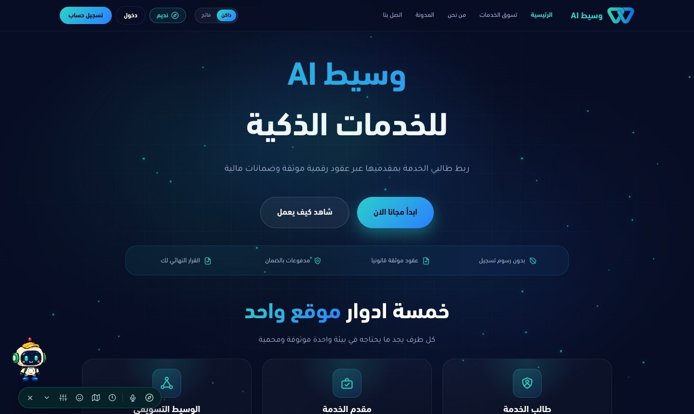
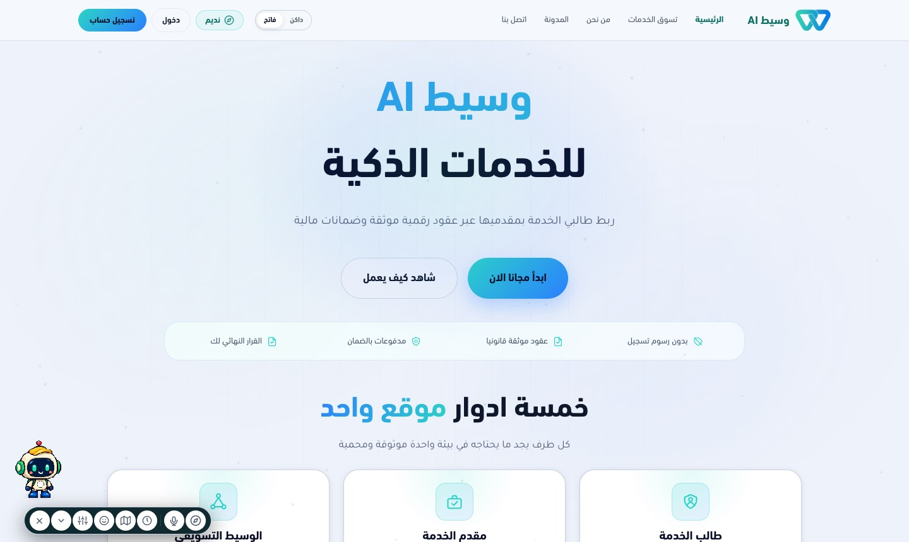
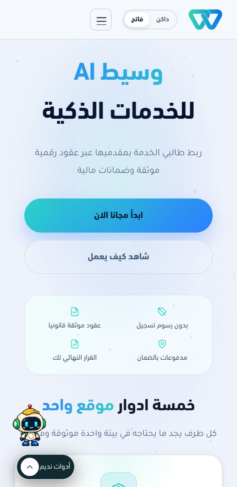

<div align="center">


**Angular web app for the Waseet AI services marketplace — public site, auth and role-based dashboards.**

[](https://angular.dev)
[](https://www.typescriptlang.org)
[](https://tailwindcss.com)
[](https://vitest.dev)

[Quick start](#quick-start) · [Configuration](#configuration) · [Scripts](#scripts) · [Structure](#project-structure) · [Docs](#documentation) · [Backend repo](https://github.com/Amr546214/waaseetai_Back)

</div>

---

## Overview

Waseet AI connects service clients with providers through requests, offers, contracts and wallet-backed payments. This repository is the **browser frontend**; all data comes from the [backend API](https://github.com/Amr546214/waaseetai_Back).

| Surface | Audience | Entry route |
|---|---|---|
| Public website (home, marketplace, about, blog, contact, legal) | Everyone, no login | `/` |
| Authentication (login, register, password reset, OTP) | Guests | `/auth/*` |
| Client dashboard | Service clients | `/client-overview` |
| Provider dashboard | Service providers | `/provider-overview` |
| Marketer dashboard | Marketing brokers | `/marketer-overview` |
| Admin dashboard | Super admins | `/supper-admin-overview` |
| Assistant | Signed-in users | `/assistant` |

The UI is Arabic-first (RTL) with a dark/light theme switch.

<table>
  <tr>
    <td colspan="2"></td>
  </tr>
  <tr>
    <td width="68%"></td>
    <td width="32%"></td>
  </tr>
</table>

<sub>Screenshots: public home page from a local run (`npm run start:local`, no backend, no user data).</sub>

## Tech stack

| Area | Technology |
|---|---|
| Framework | Angular 21 (standalone components, signals, lazy routes) with SSR (`@angular/ssr` + Express 5) |
| Language / styling | TypeScript 5.9 · Tailwind CSS 4 (PostCSS) · design tokens in `src/waseet-design-system.css` |
| i18n | `@ngx-translate/core` |
| Realtime | `socket.io-client` |
| UI libraries | `ngx-bootstrap`, `@ng-select/ng-select`, `ng2-charts`, `intl-tel-input` |
| Auth | Backend JWT + Google sign-in (`@abacritt/angularx-social-login`) |
| Tests | Vitest 4 + jsdom, run through `ng test` |

## Quick start

**Requirements:** Node.js 22 (the repo's `Dockerfile.dev` uses 22.12) and npm 10.9.

```bash
git clone https://github.com/Amr546214/waaseetai_Front.git
cd waaseetai_Front
npm ci --legacy-peer-deps        # uses package-lock.json as is; flag required: plain `npm ci` fails with ERESOLVE (@ng-select vs Angular 21)
npm run start:local              # http://localhost:4200 → API at http://localhost:5009/api
```

Run the [backend](https://github.com/Amr546214/waaseetai_Back) on port `5009` first, or most pages after the public site will not load data.

> `npm start` uses the `development` configuration, which points at the **shared dev server** (`https://dev.waseetai.com/api`), not at localhost. Use `start:local` for a local backend.
>
> Opening `http://localhost:4200` does **not** mean a local backend: `npm start` talks to the shared dev backend **and its database** with the same rules as the deployed dev site (registration, e-mail proof, phone/e-mail uniqueness, rate limits). Only `url_api` differs between configurations; no flow is switched on or off by the environment.

```bash
npm run build                 # production build → dist/frontend (browser + server bundles)
npm run serve:ssr:frontend    # serve the SSR build after `npm run build`
```

## Configuration

The API address is set per Angular configuration; `angular.json` swaps `src/environments/environment.ts` for the matching file.

| Command | Environment file | `url_api` |
|---|---|---|
| `npm run start:local` | `environment.local.ts` | `http://localhost:5009/api` |
| `npm start` | `environment.dev.ts` | `https://dev.waseetai.com/api` |
| `npm run build` | `environment.prod.ts` | `/api` (same origin, behind a reverse proxy) |

Other keys: `socketUrl`, `google_client_id`, `paypal_client_id`. Environment files are bundled into the browser, so they must only hold public values. Google sign-in only works from origins registered in Google Cloud (see [the guide](docs/frontend-guide.md#google-oauth)).

## Scripts

| Script | What it does |
|---|---|
| `npm run start:local` | Dev server against a local backend (`-c local`) |
| `npm start` | Dev server against the shared dev API (`ng serve`, development configuration) |
| `npm run build` | Production build with SSR output |
| `npm run watch` | Rebuild on change (development configuration) |
| `npm test` | Unit tests (`ng test`, Vitest) |
| `npm run serve:ssr:frontend` | Run `dist/frontend/server/server.mjs` |

No E2E framework is configured, so there is no `ng e2e`.

## Project structure

```text
src/
├── environments/        API base URLs per configuration
├── waseet-design-system.css · styles.css   Design tokens, fonts, global styles
└── app/
    ├── app.config.ts · app.routes.ts       Providers, router, route tree
    ├── core/            Auth store, guards, interceptors, models, API services
    ├── layouts/         website · auth · dashboard shells
    ├── pages/           website · auth · dashboard (client, provider, marketer, admin) · assistant
    └── sheards/         Shared UI components (existing directory name, not a typo to fix piecemeal)
public/                  Static assets (brand mark, fonts, images)
```

## Notes

- Public pages work without a session; private actions check authentication when triggered, and a `401` on an authenticated request clears the session.
- Dashboards are role-guarded; protected pages need a backend account with the matching role.
- Do not touch window/`localStorage` outside browser-only code — the app is server-rendered and hydrated.

## Documentation

| Document | Contents |
|---|---|
| [docs/frontend-guide.md](docs/frontend-guide.md) | Architecture, routing, auth/session, API layer, SSR, troubleshooting, contribution rules |
| [docs/ui-arabic-text-clipping.md](docs/ui-arabic-text-clipping.md) | Arabic text clipping in buttons and tabs |
| [docs/reviews/](docs/reviews) | Review notes |
| [Backend repository](https://github.com/Amr546214/waaseetai_Back) | API, database, deployment |
