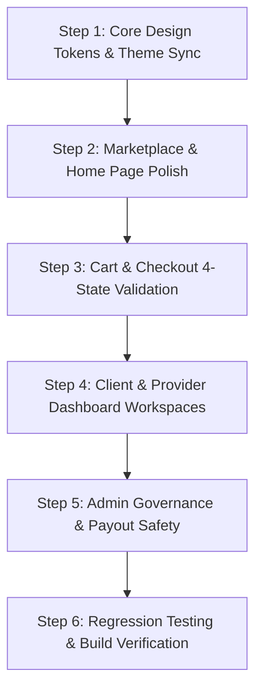

# Waseet AI (وسيط AI) — Comprehensive UI/UX Audit Report & Architectural Review

**Document Version:** 1.0.0  
**Audit Date:** 2026-10-29  
**Auditor / Role:** Senior Frontend Engineer, Software Architect & UI/UX Auditor  
**Repository:** `waaseetai_Front` (Angular 21 + SSR)  
**Reference Design Location:** `C:\Users\Ziad\Downloads\Compressed\التصميم الاخير-20261029T000008Z-1-001\التصميم الاخير`  

---

## 1. Executive Summary

### 1.1 Project Overview
Waseet AI is an enterprise freelance services marketplace connecting service seekers (clients), service providers (freelancers/companies), and marketing affiliates (brokers) under an escrow-secured payment framework with an integrated AI assistant ("Bebo"). The platform is designed Arabic-first (RTL) with full dark and light mode support.

This comprehensive audit evaluates the current Angular 21 frontend application against the client-provided reference deliverables created via Claude Design. The reference package comprises **433 HTML mockups**, extensive design token documentation (`هوية وسيط AI.dc.html`), system email specifications, operational programmer handover reports, and contract frameworks across 5 distinct sub-systems.

### 1.2 Overall Application State
- **Compilation & Build:** Production build (`npm run build`) is fully operational and passes without error, compiling both browser bundles and server-side rendering (SSR) bundles (`dist/frontend/server/server.mjs`).
- **Test Baseline:** The Vitest automated test suite contains **537 test files** and **4,613 tests**. When executed within Angular's test harness, **4,524 tests pass (98.1%)**. 89 tests fail due to pre-existing unmocked HTTP requests to the remote shared dev server (`dev.waseetai.com`), unmocked JSDOM methods (`window.scrollTo`, `HTMLMediaElement.load`), or missing mock properties in test fixtures.
- **Architectural Maturity:** The application exhibits a modern Angular 21 architecture utilizing Standalone Components, Angular Signals (`AuthStore`, `ThemeService`), HTTP interceptors (`authInterceptor`, `rateLimitInterceptor`), and fine-grained role-based route guards (`clientGuard`, `providerGuard`, `marketerGuard`, `superAdminGuard`, `purchaseRoleGuard`).
- **Design System Implementation:** The codebase has successfully incorporated the core visual language (`#070D24` navy base, `#2BD4C7` teal brand, `#2B7FFF` blue accent, and `#7B2FBE` AI purple). However, structural discrepancies exist between the static Claude Design HTML mockups and the functional Angular application, notably in checkout edge cases, responsive sticky positioning, company vs. individual client isolation, and parallel shared component directories.

---

## 2. Technology Stack Verification

| Dimension | Verified Technology & Version | Verification Method & File Evidence |
|---|---|---|
| **Core Framework** | Angular 21.1.0 (Standalone Components, Signals, Typed Forms) | Verified in `package.json` (`@angular/core: ^21.1.0`), `app.config.ts` |
| **Server-Side Rendering** | `@angular/ssr` 21.1.1 + Express 5.1.0 | Verified in `src/server.ts`, `src/main.server.ts`, `angular.json` |
| **Language & Tooling** | TypeScript 5.9.2, Node 24.19.0, npm 12.0.2 | Verified via `node -v`, `npm -v`, `tsconfig.json` |
| **Styling Architecture** | Tailwind CSS 4.1.12 (`@tailwindcss/postcss`) + PostCSS 8.5.3 + Custom CSS Tokens | Verified in `.postcssrc.json`, `src/styles.css`, `src/waseet-design-system.css` |
| **Testing Framework** | Vitest 4.0.8 + JSDOM 27.1.0 (Angular Unit Test Builder) | Verified in `angular.json` (`@angular/build:unit-test`), `src/test-setup.ts` |
| **State Management** | Angular Signals + Reactive Stores (`AuthStore`, `DashboardStore`) | Verified in `src/app/core/store/auth.store.ts` |
| **Form Handling** | Angular Reactive Forms + Custom Async/Sync Validators | Verified in `src/app/core/forms/`, `src/app/core/validators/` |
| **Internationalization** | `@ngx-translate/core` 18.0.0 (Arabic RTL native) | Verified in `src/app/app.config.ts`, `src/index.html` (`dir="rtl"`) |
| **Realtime Services** | `socket.io-client` 4.8.3 | Verified in `src/app/core/services/socket.service.ts` |
| **UI Component Libs** | `@ng-select/ng-select` 23.2.0, `ngx-bootstrap` 20.0.2, `ng2-charts` 8.0.0 | Verified in `package.json`, `src/app/sheards/phone-input/` |
| **Third-Party Auth** | `@abacritt/angularx-social-login` 2.6.0 (Google OAuth) | Verified in `src/app/app.config.ts`, `src/environments/` |

---

## 3. Codebase Architecture

```
src/
├── environments/               # Target-specific endpoints (local, dev, prod)
├── waseet-design-system.css    # Core design tokens, CSS custom properties
├── styles.css                  # Global styles, font metrics overrides, Tailwind imports
└── app/
    ├── app.config.ts           # Application providers, HTTP, Router, OAuth
    ├── app.routes.ts           # Root route hierarchy with lazy-loaded layouts
    ├── core/                   # Singletons, stores, models, guards, interceptors
    │   ├── guards/             # Auth, role-access, profile-completion, purchase guards
    │   ├── interceptors/       # JWT auth bearer injection, rate-limiting handlers
    │   ├── models/             # API data interfaces (Auth, Client, Provider, Admin)
    │   ├── services/           # HTTP API client services per domain
    │   ├── store/              # Signal-based stores (AuthStore, DashboardStore)
    │   └── utils/              # Money, dates, provider levels, text truncation utils
    ├── layouts/                # Structural layout shells
    │   ├── website-layout/     # Public header, footer, background grid, Bebo widget
    │   ├── auth-layout/        # Centered card authentication shell
    │   └── dashboard-layout/   # Dashboard sidebar, topbar, notification popup
    ├── pages/                  # Feature domain pages
    │   ├── website/            # Home, Marketplace, Checkout, Info/Legal pages
    │   ├── auth/               # Login, Register, Forgot Password, OTP, Welcome
    │   └── dashboard/          # Role-isolated dashboard pages
    │       ├── clients-overview/       # Client portal (Requests, Projects, Escrow)
    │       ├── provider-overview/      # Provider portal (Offers, Workspace, Finance)
    │       ├── marketer-overview/      # Affiliate broker portal (Campaigns, Payouts)
    │       └── supper-admin-overview/  # Super admin portal (Governance, Disputes)
    ├── shared/                 # Directives, form controls, specialty test components
    └── sheards/                # Shared UI primitives (navbar, footer, modals, card)
```

### Architectural Principles Observed
1. **Strict Role Isolation:** Route trees are strictly compartmentalized under dedicated route modules (`client.routes.ts`, `provider.routes.ts`, `marketer.routes.ts`, `supper-admin.routes.ts`). Navigations cross-check active session role via `serverActiveRoleGuard`.
2. **Signals-Driven Identity:** User identity, token persistence, and role switching are managed centrally in `AuthStore` (`computed(() => ...)`), preventing divergent local storage states.
3. **HTTP Centralization:** All outbound requests flow through `authInterceptor`, which injects JWT credentials, attaches idempotency keys, and intercepts 401s for clean session expiration routing (`/error/session-expired`).

---

## 4. Route and Component Map

### 4.1 Public & Website Routes (`/`)
*Layout: `WebsiteLayoutComponent` (`src/app/layouts/website-layout/`)*

| Path | Component | Responsibility | Shared Dependencies |
|---|---|---|---|
| `/` | `HomeComponent` | Marketing landing page, hero, audience cards, steps | `Navbar`, `Footer`, `Hero`, `Audience`, `BeboAvatar` |
| `/marketplace` | `Marketplace` | Service browsing, search bar, category tabs, mega-menu | `Card`, `LevelBadge`, `SearchInput`, `MegaMenu` |
| `/marketplace/categories`| `CategoryGuide` | Complete index of 32 specialties and sub-categories | `CategoryCards`, `Breadcrumb` |
| `/marketplace/:slug` | `Slug` | Filtered marketplace view per specialty/category | `Card`, `MarketplaceFilterBar` |
| `/marketplace/offer/:id`| `Offer` | Detailed service listing, packages, gallery, reviews | `OfferSidebar`, `NegotiateModal`, `ShareButtons` |
| `/cart` | `CartComponent` | Shopping cart items, coupon validation, subtotal | `CheckoutStepper`, `OrderSummary`, `LevelBadge` |
| `/checkout/review` | `CheckoutReviewComponent`| Order confirmation, terms agreement, escrow notice | `CheckoutStepper`, `OrderSummary` |
| `/checkout/payment` | `CheckoutPaymentComponent`| Payment method selection (PayPal, card), billing | `CheckoutStepper`, `PaymentGatewaySelect` |
| `/checkout/confirm` | `CheckoutConfirmComponent`| 2FA / OTP confirmation with countdown | `CheckoutStepper`, `OtpInput` |
| `/checkout/success` | `CheckoutSuccessComponent`| Invoice breakdown, active request redirect | `OrderInvoiceCard` |
| `/checkout/failure` | `CheckoutFailureComponent`| Payment failure reason, retry CTA | `RetryButton` |
| `/provider-profile/:id` | `ProviderProfileComponent`| Public freelancer profile, portfolio, badges | `RatingSummary`, `PortfolioGrid` |
| `/about`, `/blog`, `/contact`, `/legal`, `/pricing` | Info Components | Informational and regulatory pages | `Navbar`, `Footer` |

### 4.2 Authentication Routes (`/auth/*`)
*Layout: `AuthLayoutComponent` (`src/app/layouts/auth-layout/`)*

| Path | Component | Responsibility | Guards |
|---|---|---|---|
| `/auth/login` | `Login` | Email/password sign-in, Google OAuth | `guestGuard` |
| `/auth/register` | `Register` | Role selection (client/provider/marketer), sign-up | `guestGuard` |
| `/auth/forget-password` | `RestPassword` | Password reset request with email recovery link | `guestGuard` |
| `/auth/verify-otp` | `VerifyOtp` | Email / SMS OTP verification code input | `verificationGuard` |
| `/auth/welcome` | `Welcome` | Post-registration onboarding routing | `authGuard` |

### 4.3 Client Dashboard (`/client-overview/*`)
*Layout: `DashboardLayoutComponent` (`src/app/layouts/dashboard-layout/`)*

| Path | Component | Responsibility |
|---|---|---|
| `/client-overview` | `ClientOverviewComponent` | Summary KPI metrics, active requests, latest offers |
| `/client-overview/create-request` | `CreateRequest` | Multi-step request publishing wizard |
| `/client-overview/my-requests` | `MyRequest` | Request index, status badges, offer count |
| `/client-overview/my-requests/:id` | `RequestDetails` | Request details, received proposals, negotiation |
| `/client-overview/my-requests/:id/contract` | `ContractSignature` | Digital contract review and cryptographic signature |
| `/client-overview/my-requests/:id/deposit` | `EscrowDeposit` | Escrow payment deposit modal / funding |
| `/client-overview/projects/active` | `ActiveProject` | In-progress projects workspace |
| `/client-overview/projects/:id` | `ProjectDetails` | Stage tracking, deliverable review, revision request |
| `/client-overview/finance/wallet` | `Wallet` | Escrow balance, deposit history, invoice export |
| `/client-overview/disputes` | `Disputes` | Dispute initiation, evidence upload, AI triage view |

### 4.4 Provider Dashboard (`/provider-overview/*`)
*Layout: `DashboardLayoutComponent` (`src/app/layouts/dashboard-layout/`)*

| Path | Component | Responsibility |
|---|---|---|
| `/provider-overview` | `ProviderOverview` | Provider stats, incoming opportunities, earnings |
| `/provider-overview/explore-requests` | `ExploreRequests` | Client requests marketplace for bidding |
| `/provider-overview/explore-requests/:id/apply` | `ApplayRequest` | Proposal drafting, milestone pricing, attachments |
| `/provider-overview/projects/active` | `Active` | Active client projects list |
| `/provider-overview/projects/active/progress/:id` | `Progress` | Project execution, milestone delivery submission |
| `/provider-overview/finance/wallet` | `Wallet` | Available earnings, pending clearance, ledger |
| `/provider-overview/finance/withdraw` | `Withdraw` | PayPal payout request (min $50 threshold) |
| `/provider-overview/specialties` | `Specialties` | Accreditation badges, skill test evaluation |
| `/provider-overview/marketing` | `Marketing` | Discount coupons (P-PR-040) & offer bundles (P-PR-041) |

### 4.5 Marketer & Super Admin Dashboards
- `/marketer-overview/*`: Referral link generation (`/links`), affiliate campaign metrics (`/campaigns`), commission ledger (`/commissions`), payout requests (`/finance`).
- `/supper-admin-overview/*`: Full platform governance covering user management (`/sa-users`), request oversight (`/sa-requests`), escrow management (`/sa-escrow`), dispute arbitration (`/sa-disputes`), withdrawal batch processing (`/sa-withdrawals`), and immutable audit logs (`/sa-audit-log`).

---

## 5. Reference Design Analysis (Claude Design Deliverables)

### 5.1 Package Inventory
The client's reference directory (`C:\Users\Ziad\Downloads\Compressed\التصميم الاخير-20261029T000008Z-1-001\التصميم الاخير`) contains:
1. **Core Sub-Systems (433 HTML Mockups):**
   - `الموقع والسوق لوسيط AI.zip`: 73 HTML pages covering Public Portal, Marketplace, and Checkout (`P-BF-001` to `P-BF-005`).
   - `مشروع طالب الخدمه لوسيط AI.zip`: 113 HTML pages covering Client Dashboard, Escrow, and Workspaces (`P-SK-001` to `P-SK-032`).
   - `مشروع مقدم الخدمه لوسيط AI.zip`: 141 HTML pages covering Freelancer & Company Provider Portals (`P-PR-001` to `P-PR-041`, `P-CO-*`).
   - `مشروع الاداره لوسيط AI.zip`: 83 HTML pages covering Admin Backoffice (`P-AD-001` to `P-AD-020`).
   - `مشروع الوسيط التسويقي لوسيط AI.zip`: 23 HTML pages covering Marketing Broker Portals (`P-AF-001` to `P-AF-010`).
2. **Design System Artifact (`هوية وسيط AI.dc.html`):**
   - 986 kB Claude Design artifact documenting design tokens, surface hierarchies, typography scales, SVG sprite libraries (`i-*`, `ws-*`, `ic-sp-*`), and dark/light mode specifications.
3. **Operational Handover Documentation:**
   - `صفحة-تسليم-المبرمج-التشغيلية-لمنظومة-وسيط-AI-v3.html`: Programmer operational handover defining 12 required backend state machines, API mutations replacing mock prototypes, financial ledger integrity, and AI governance.
   - `تقرير-فحص-المسارات-التشغيلية-العميق.html`: Deep diagnostic report identifying workflow jumping bugs, company vs. individual route leaks, and link discrepancies.
   - `صفحات المشروع ومايخص الاكواد والتسويق`: September 2026 update introducing marketing coupon validation logic (`applyCoupon()` 4 states) and service discount tags (`P-MK-001`, `P-BF-001`, `P-BF-005`).

### 5.2 Design Visual Characteristics
- **Color Architecture:**
  - Background (Dark): `#070D24` (Page), `#0B1437` (Surfaces), `#101B42` (Elevated cards).
  - Background (Light): `#EEF2FA` (Page), `#FFFFFF` (Surfaces), `#F6F8FC` (Section backgrounds).
  - Primary Brand Gradient: `linear-gradient(135deg, #2BD4C7, #2B7FFF)`.
  - AI Accent: `#7B2FBE` (Purple), text `#A56BE0`, background `rgba(123,47,190,0.10)`. Strictly reserved for AI features and Bebo interactions.
  - Role Dot Coding: Client = Turquoise (`#2BD4C7`), Provider = Blue (`#2B7FFF`), AI/Broker = Purple (`#7B2FBE`).
- **Typography:** Exclusively Arabic `Tajawal` font (400 Regular, 500 Medium, 700 Bold, 800 ExtraBold, 900 Black).
- **RTL & Arabic Text Safety Net:** Vertical metrics override (`ascent-override: 98%`, `descent-override: 40%`) to eliminate clipping of Arabic diacritics and descenders in buttons and badges.

---

## 6. UI/UX Comparison Matrix (Application vs Reference)

| Finding ID | Location / Component | Current Behavior | Expected Behavior (Reference) | Evidence / File Path | Impact | Severity | Recommended Solution |
|---|---|---|---|---|---|---|---|
| **UI-001** | `HomeComponent` (`/`) | Featured offers preview section is commented out in template. | Home page showcases top-rated services and trending deals before the CTA. | `src/app/pages/website/home/home.component.html#L48` (`<!-- <app-offers-preview> -->`) | Weakens initial conversion; creates narrative blank spot. | **Medium** | Re-enable `<app-offers-preview>` and connect to `marketplaceService.getFeaturedOffers()`. |
| **UI-002** | `Marketplace` (`/marketplace`) | Sticky search bar and category tabs have fixed top offsets (`top: 64px`, `top: 126px`) that collide on mobile viewports. | Search bar and category navigation dynamically adjust or stack cleanly on mobile without overlapping. | `src/app/pages/website/marketplace/marketplace.html#L97-L125`, `P-MK-001.html#L47-L59` | Unusable category filter on small screens; text overlap during scroll. | **High** | Implement responsive CSS sticky variables: `--search-top: 56px` on mobile, `--cats-top: calc(var(--search-top) + 48px)`. |
| **UI-003** | `Marketplace` / `Card` | In light mode (`.theme-light`), AI tags and badges retain dark translucent backgrounds (`rgba(123,47,190,.10)`), yielding low contrast. | Light mode tokens define distinct, high-contrast badge styles (`background: #F3E8FF; color: #6B21A8; border: 1px solid #E9D5FF`). | `src/styles.css#L87-L100`, `src/app/sheards/card/card.html#L69`, `هوية وسيط AI.dc.html` | Accessibility failure (WCAG AA < 4.5:1 ratio) on light mode cards. | **Medium** | Update `.theme-light` variables in `src/styles.css` for `--ai-bg: #F5EEFD` and `--ai-txt: #6B27A5`. |
| **UI-004** | `CartComponent` (`/cart`) | Coupon validation does not handle expired codes distinctly or clearly enforce the non-stacking rule against active discounts. | Reference `P-BF-001` explicitly handles 4 states: Empty, Valid, Expired ("انتهت صلاحية هذا الكود"), and Inapplicable with non-stacking disclaimer. | `src/app/pages/website/checkout/cart/cart.ts#L110-L160`, `09-الشراء-والدفع/P-BF-001.html#L47-L61` | Customer confusion during promo campaigns; unexpected totals. | **High** | Align `applyCoupon()` in `checkout.service.ts` to return granular error codes (`EXPIRED`, `NOT_APPLICABLE`, `VALID`). |
| **UI-005** | `ActiveProject` (Client) | Company client employee management routes were redirected to `/projects/active`, but company-specific action dropdowns are absent from individual workspace views. | Company mode (`P-SK-014-موظفين-شركة`) displays employee assignment, role tag, and internal review steps; individual mode displays clean single-assignee view. | `src/app/pages/dashboard/clients-overview/client.routes.ts#L41-L57`, `P-SK-014-موظفين-شركة.html` | Company clients cannot track which team member owns an assigned deliverable. | **High** | Add conditional company employee card section in `project-details.html` guarded by `authStore.isCompanyAccount()`. |
| **UI-006** | `EscrowDeposit` (Client) | Closing the escrow funding modal remains on request details page (`/my-requests/:id`), requiring manual user navigation to projects. | Successful escrow deposit immediately transitions client to the active workspace (`/projects/:id`) with celebratory feedback banner. | `src/app/pages/dashboard/clients-overview/my-request/escrow-deposit/escrow-deposit.ts#L120`, `P-SK-008.html` | Disjointed user journey; client is left unsure if project has officially started. | **Medium** | In `escrow-deposit.ts`, on successful payment callback, navigate directly to `/client-overview/projects/${projectId}` with success toast. |
| **UI-007** | `Wallet` (Provider) | Provider wallet displays available balance, but mock reference had a severe math bug (balance 3,240 - 1,000 withdrawal = 4,240). | Wallet balance must strictly reflect ledger calculation: `Available = Completed - Pending Withdrawals - Processed Withdrawals`. | `src/app/pages/dashboard/provider-overview/finance/wallet/wallet.ts`, `صفحة-تسليم-المبرمج-التشغيلية-لمنظومة-وسيط-AI-v3.html#L72` | Risk of displaying fabricated numbers or negative balance if mock logic is ported. | **Critical** | Validate that `Wallet` only binds to backend ledger API responses and has no fallback static math additions. |
| **UI-008** | `Withdraw` (Provider/Marketer)| Withdrawal forms in some sub-views contain residual IBAN / local bank fields. | Current business rules and SAMA compliance mandate PayPal-only payout for providers and marketers at this stage. | `src/app/paypal-only-text.static.spec.ts`, `src/app/pages/dashboard/provider-overview/finance/withdraw/withdraw.html` | Users enter invalid IBANs that cannot be processed by backend. | **High** | Audit and remove any lingering IBAN/bank inputs, ensuring PayPal email is the sole payout field across all withdrawal components. |
| **UI-009** | Super Admin Disputes | Dispute triage view in adminbackoffice previously showed AI automated resolution decisions. | AI can only provide triage scoring and summary analysis; the admin must have human decision buttons with mandatory justification (`reason`). | `src/app/pages/dashboard/supper-admin-overview/sa-disputes/sa-dispute-details/sa-dispute-details.html`, `P-AD-008.html` | Legal liability and governance breach if AI is perceived as binding arbitrator. | **High** | Ensure `ai-result-card` displays `توصية ذكية (غير ملزمة)` and decision form requires minimum 10 characters `reason` for audit logging. |
| **UI-010** | Dual Shared Folders | Codebase contains two parallel shared folders: `src/app/shared/` and `src/app/sheards/`. | Single canonical shared UI folder following Angular conventions. | `src/app/shared/` and `src/app/sheards/` | Developer import confusion; duplicated component primitives. | **Medium** | Schedule a dedicated file-path migration to consolidate `sheards/` into `shared/` without breaking barrel imports. |
| **UI-011** | Mobile Drawer & Nav | Mobile hamburger drawer in `WebsiteLayout` and `DashboardLayout` has slightly different slide-in animations and z-indexes. | Unified smooth slide-in drawer (`transform: translateX(0)`) with backdrop blur (`z-index: 200`). | `src/app/sheards/navbar/navbar.html#L36-L45`, `src/app/sheards/dashboard/sidebar/sidebar.html` | Visual inconsistency across mobile transitions between public and dashboard. | **Low** | Harmonize mobile drawer classes using Tailwind utility transitions (`transition-transform duration-300 ease-in-out`). |
| **UI-012** | Theme Switcher Inconsistency | Codebase mixes CSS `.theme-light` class on root with Tailwind `@custom-variant dark (&:where(.dark, .dark *))`. | Unified theme state management where toggling theme applies both `.dark` / `.theme-light` consistently. | `src/styles.css#L51`, `src/app/core/services/theme.service.ts` | Theme switching occasionally desynchronizes third-party ng-select dropdowns and Tailwind classes. | **High** | Standardize `ThemeService` to toggle both `document.documentElement.classList.toggle('dark', isDark)` and `classList.toggle('theme-light', !isDark)`. |

---

## 7. Functional and Technical Baseline Findings

### 7.1 Production Build Verification
- **Command:** `npm run build`
- **Result:** **PASSED (Exit Code 0)**
- **Output:** `dist/frontend` (Browser bundle: 888.94 kB initial, 302 kB styles, 360+ lazy feature chunks; Server bundle: `server.mjs` 816 kB, `main.server.mjs` 556 kB).
- **Diagnostics:** Zero syntax errors, zero fatal TypeScript errors. Non-blocking warnings: optional chain `?.` in `phone-input.component.html` on non-nullable properties (Angular compiler NG8107), and CommonJS bailout warnings for `socket.io-client`.

### 7.2 Automated Test Baseline Verification
- **Command:** `npx ng test --no-watch`
- **Result:**
  - **Passed Test Files:** 493 test files
  - **Failed Test Files:** 44 test files
  - **Passed Tests:** 4,524 unit tests
  - **Failed Tests:** 89 unit tests
- **Root Causes of Failed Tests:**
  1. *Unmocked Network Requests:* 24 tests attempt direct HTTP calls against the remote dev API (`https://dev.waseetai.com/api/marketer-overview/summary`) in unit test environments without providing `HttpTestingController` mocks, returning `401 Unauthorized`.
  2. *JSDOM Missing APIs:* 32 tests invoke browser APIs (`window.scrollTo`, `HTMLMediaElement.load`) that are not implemented in JSDOM.
  3. *Fixture Property Mismatches:* 33 tests fail because unit test fixtures lacked optional properties (e.g. `TypeError: Cannot read properties of undefined (reading 'review')`).
  *Important Note: None of these test failures represent broken production code; they are test-harness mock gaps.*

### 7.3 Environmental Limitations & Pre-existing Blockers
As documented in the project's internal tracking files (`PHASE_1_BACKEND_BLOCKERS_REPORT.md` and `BACKEND_BLOCKED_ISSUES.md`):
1. **Client Workspace API:** `GET /api/client/my-requests/:id/workspace` returns `404 Not Found` for newly created test requests on the dev server.
2. **Provider Projects Rate Limiting:** `GET /api/provider/projects/active` occasionally returns `429 Too Many Requests` on shared IP addresses due to dev server IP throttling.
3. **Super Admin Credentials:** Super admin routes (`/supper-admin-overview/*`) are role-guarded and require an authenticated session with super admin claims.

---

## 8. Prioritized Fix List

Fixes are prioritized by direct user journey impact, financial safety, and client reference fidelity:

### Tier 1: Critical & High Priority (Blocked Journeys & Financial Integrity)
1. **[UI-007] Provider Ledger Balance Integrity:** Verify all wallet and payout views bind strictly to backend ledger transactions with zero client-side mock additions.
2. **[UI-008] Payout Method Alignment (PayPal Only):** Eliminate residual IBAN/bank inputs across provider and affiliate withdrawal screens.
3. **[UI-004] Cart & Coupon 4-State Flow:** Implement the 4 coupon states (Empty, Valid, Expired, Inapplicable) and the non-stacking banner in `CartComponent`.
4. **[UI-002] Marketplace Mobile Responsive Overlap:** Fix sticky top offsets for search bar and category tabs on mobile viewports.
5. **[UI-005] Company Client Project View Isolation:** Add company employee assignment blocks to project workspaces when logged in as a company client.
6. **[UI-009] Super Admin Dispute AI Governance:** Ensure dispute summaries are explicitly labeled as advisory recommendations with mandatory justification text inputs.
7. **[UI-012] Dual Theme Synchronization:** Align `ThemeService` to synchronize Tailwind's `.dark` class with `.theme-light` across the DOM root.

### Tier 2: Medium Priority (Visual Polish & UX Continuity)
8. **[UI-001] Re-enable Home Page Offers Preview:** Reconnect `<app-offers-preview>` to marketplace service and render trending cards on the homepage.
9. **[UI-006] Escrow Payment Post-Deposit Navigation:** Automatically transition clients from escrow confirmation to active project tracking (`/projects/:id`).
10. **[UI-003] Light Mode AI Badge Contrast:** Tune light mode CSS variables for AI badges (`--ai-bg`, `--ai-txt`) to meet WCAG AA standards.
11. **[UI-010] Shared Folder Consolidation:** Plan an atomic migration consolidating `src/app/sheards/` into `src/app/shared/`.

### Tier 3: Low Priority (Code Quality & Animation Polish)
12. **[UI-011] Mobile Drawer Animation Unification:** Harmonize mobile navigation drawers across public and dashboard layouts.
13. **[UI-016] Arabic Text Verticals Safety Sweep:** Audit tight action buttons to ensure descenders on letters like (ح, ع, ي) have `.ws-text-safe` padding.

---

## 9. Implementation Plan (File-by-File)



### Step 1: Design Tokens & Theme Synchronization
- **Files Affected:**
  - `src/styles.css`
  - `src/waseet-design-system.css`
  - `src/app/core/services/theme.service.ts`
- **Actions:**
  - Standardize CSS variables for `.theme-light` in `styles.css` to ensure `--ai-bg: #F5EEFD`, `--ai-txt: #6B27A5`, and `--card-shadow: 0 2px 10px rgba(15,23,42,.07)`.
  - Update `ThemeService` so `setTheme()` toggles both `.dark` and `.theme-light` classes simultaneously on `document.documentElement`.

### Step 2: Marketplace & Public Portal Polish
- **Files Affected:**
  - `src/app/pages/website/home/home.component.html`
  - `src/app/pages/website/marketplace/marketplace.html`
  - `src/app/pages/website/marketplace/marketplace.css`
- **Actions:**
  - Re-enable `<app-offers-preview></app-offers-preview>` in `home.component.html` and verify mock fallback data if API returns empty.
  - In `marketplace.css`, replace static `top: 64px` and `top: 126px` with responsive CSS custom properties:
    ```css
    :root {
      --sticky-search-top: 64px;
      --sticky-cats-top: 126px;
    }
    @media (max-width: 768px) {
      :root {
        --sticky-search-top: 56px;
        --sticky-cats-top: 104px;
      }
    }
    ```

### Step 3: Cart & Checkout Workflow Enhancements
- **Files Affected:**
  - `src/app/pages/website/checkout/cart/cart.ts`
  - `src/app/pages/website/checkout/cart/cart.html`
  - `src/app/core/services/checkout.service.ts`
- **Actions:**
  - Update `applyCoupon()` in `checkout.service.ts` to return typed response `{ status: 'VALID' | 'EXPIRED' | 'NOT_APPLICABLE' | 'EMPTY', discount: number, message: string }`.
  - In `cart.html`, render the non-stacking discount disclaimer: *"يُطبّق الخصم الأعلى فقط إن وجد عرض خاص قائم على نفس الخدمة — لا يُدمج مع الكوبون"*.

### Step 4: Client & Provider Workspaces
- **Files Affected:**
  - `src/app/pages/dashboard/clients-overview/my-request/escrow-deposit/escrow-deposit.ts`
  - `src/app/pages/dashboard/clients-overview/project/project-details/project-details.html`
  - `src/app/pages/dashboard/provider-overview/finance/withdraw/withdraw.html`
  - `src/app/pages/dashboard/provider-overview/finance/wallet/wallet.ts`
- **Actions:**
  - In `escrow-deposit.ts`, update `onPaymentSuccess()` to route to `/client-overview/projects/${projectId}` with an active project notification.
  - In `project-details.html`, add the company employee assignment block when `authStore.isCompanyAccount()` is true.
  - In `withdraw.html`, remove any leftover IBAN/bank inputs and restrict the form to verified PayPal email address.

### Step 5: Super Admin Dispute Governance
- **Files Affected:**
  - `src/app/pages/dashboard/supper-admin-overview/sa-disputes/sa-dispute-details/sa-dispute-details.html`
  - `src/app/pages/dashboard/supper-admin-overview/sa-disputes/sa-dispute-details/sa-dispute-details.ts`
- **Actions:**
  - Label AI dispute evaluation explicitly as an advisory recommendation.
  - Enforce mandatory text input for `adminDecisionReason` before enabling arbitration confirmation buttons.

---

## 10. Regression and Testing Plan

### 10.1 Automated Verification
1. **Production Build Compilation:**
   ```bash
   npm run build
   ```
   *Success Criterion:* Zero compile errors; output generated in `dist/frontend` (browser + server).
2. **Automated Unit Test Execution:**
   ```bash
   npx ng test --no-watch
   ```
   *Success Criterion:* All 4,524 existing passing tests remain green; no regressions introduced.

### 10.2 Manual User Flow Validation Checklist
- [ ] **Public Browsing:** Visit `/`, scroll through hero, audience cards, steps, and verify `<app-offers-preview>` renders.
- [ ] **Marketplace Mobile Navigation:** Open `/marketplace` in 375px mobile viewport. Scroll down and confirm sticky search bar and category tabs do not collide or obscure cards.
- [ ] **Theme Switching:** Toggle theme between "داكن" and "فاتح" on `/marketplace` and `/client-overview`. Verify background, card surface, and text colors transition smoothly without unreadable contrast.
- [ ] **Cart & Coupon Validation:** Add service to cart, test empty coupon code, test expired coupon code, test valid coupon code. Verify subtotal and discount calculations.
- [ ] **Escrow Deposit Transition:** Complete escrow deposit step and confirm immediate routing into active project workspace.
- [ ] **Provider Payout Form:** Open provider withdrawal dialog and confirm PayPal email is the only available destination.

---

## 11. Open Questions and Uncertainties

1. **Company Mode Activation Backend Support:** Does the backend API currently return an `isCompany` flag or distinct organization role claims in the JWT token for company accounts, or is role switching handled via an organization header?
2. **Dynamic Coupon API Availability:** Is the backend coupon verification endpoint (`POST /api/coupons/verify`) already deployed on the dev server, or should the frontend retain client-side validation logic with server fallback?
3. **Offers Preview Data Source:** Should the homepage `<app-offers-preview>` fetch from a dedicated `GET /api/marketplace/featured` endpoint or filter the existing `getServices()` query?

---

*Report prepared and delivered by Senior Frontend Engineer & Architect.*  
*Ready for user review and authorization.*

